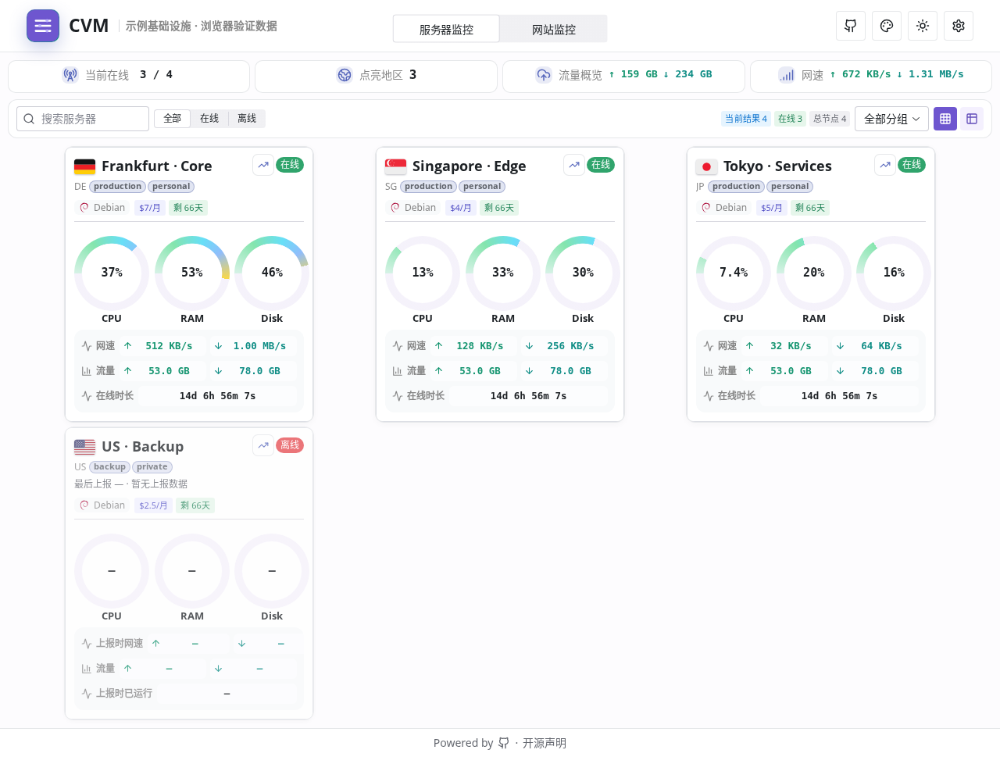
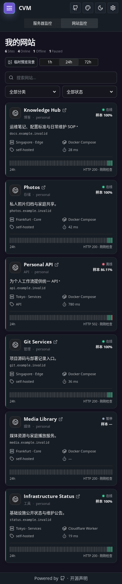
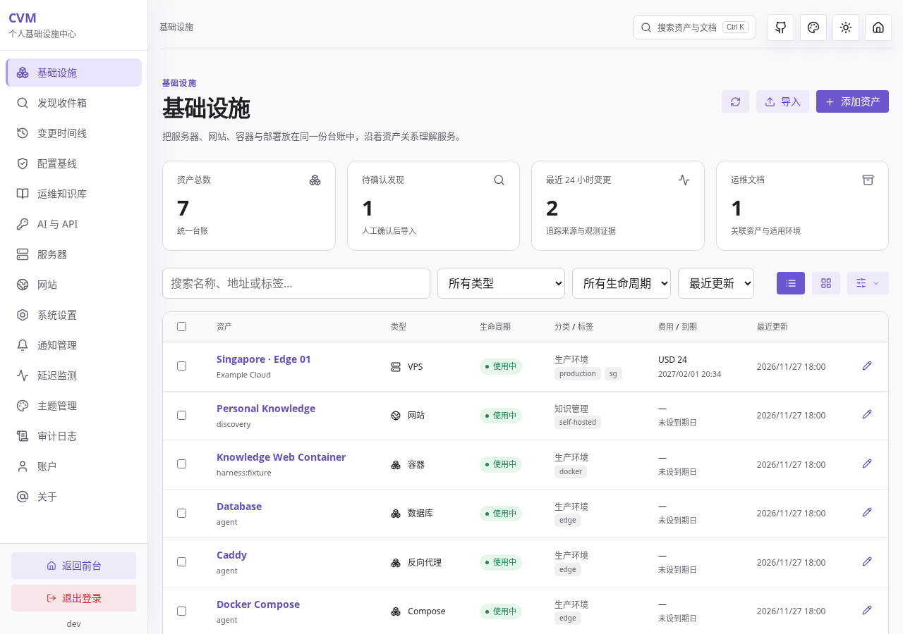
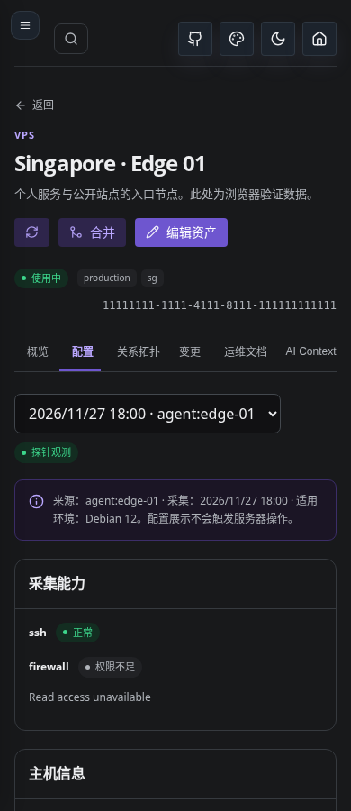

# CVM 视觉验证记录

本目录保留四张实际 Chromium 浏览器渲染截图，覆盖公开页面与管理后台、桌面视口与手机视口、浅色与深色主题。截图来自当前前端源码的隔离浏览器回归，已实际查看布局、文字可读性、状态表达与横向溢出情况。

**全部资产、主机、监控指标和配置证据均为合成测试数据，不代表生产资产或生产运行状态。** 浏览器使用独立上下文、空环境目录和受控 API 响应，外部请求被阻断，没有读取生产凭据或修改生产环境。手机截图验证的是手机尺寸视口，不是实体设备测试。

## 保留的截图

| 截图 | 界面与主题 | 观察重点 | 对应场景 |
| --- | --- | --- | --- |
| [公开 VPS 桌面页](public-vps-desktop.png) | 桌面、Monitor 浅色 | 多节点网格、资源指标、在线与离线状态、缺测值 | CVM-12-desktop |
| [公开网站手机页](public-websites-mobile.png) | 手机、Monitor 深色 | 网站卡片、在线/离线/暂停、未知心跳、长页面适配 | CVM-12-mobile |
| [资产管理桌面页](assets-desktop.png) | 桌面、浅色 | 管理导航、总览、筛选、资产列表与信息密度 | CVM-01 |
| [配置详情手机页](configuration-mobile.png) | 手机、深色 | 配置证据、来源与时间、未知/权限不足状态、窄屏排列 | CVM-05 |

### 公开 VPS · 桌面

### 公开网站 · 手机

### 资产管理 · 桌面

### 配置详情 · 手机

## 复现与证据边界

运行条件、命令、场景编号、截图输出位置及相关核心验证见 [前端浏览器回归说明](../../frontend/browser/README.md)。本目录为已有验证的代表截图记录，不表示生产部署或 Release 已完成。

这些截图证明对应源码在浏览器中的实际渲染结果；配套浏览器回归检查交互与请求载荷。数据库迁移、服务端权限、真实探针采集及生产端到端联调需要各自的运行证据，不能由合成数据截图替代。
